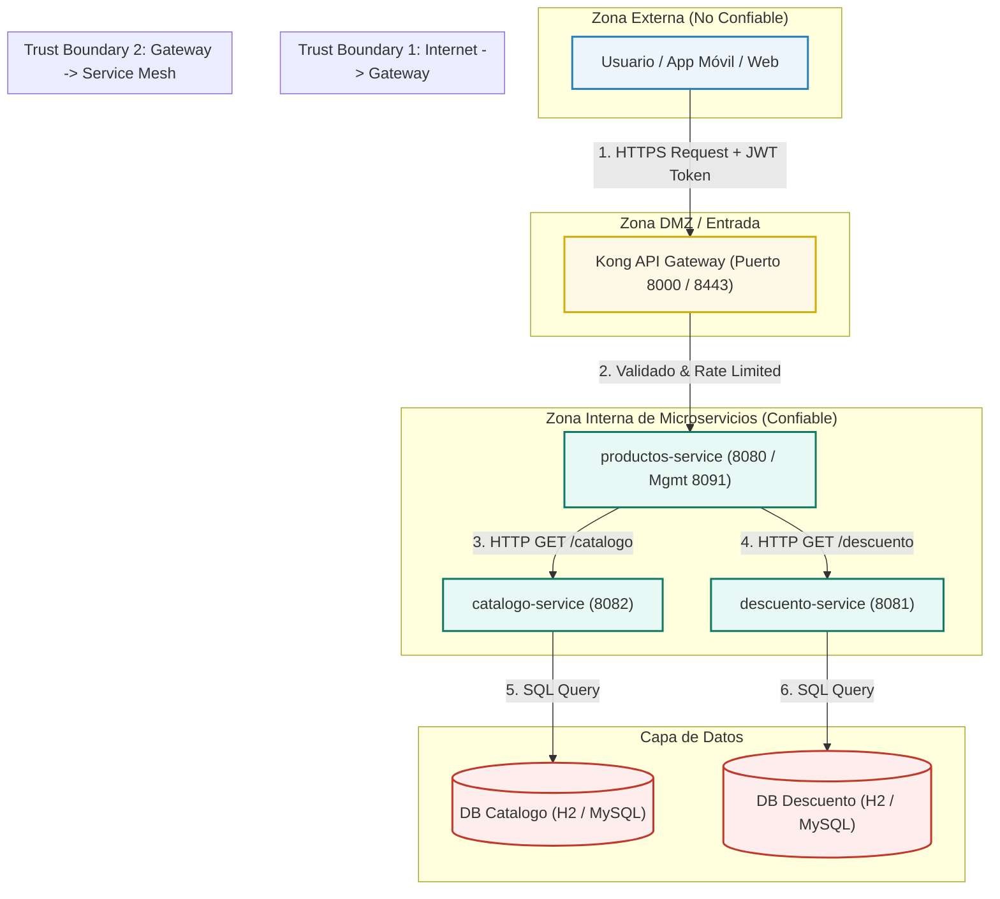

# Modelado de Amenazas (STRIDE) y DFD — Microservicios Bootcamp

**Autor:** Arturo Mora  
**Fecha:** 22/09/2026  
**Módulo:** Módulo 2 — Sesión 4 (Ejercicio 6)  
**Proyecto:** Arquitectura de Microservicios y Kong API Gateway  

---

## 1. Introducción
El presente documento define el análisis de seguridad mediante la metodología **STRIDE** para los componentes expuestos a través de **Kong API Gateway** en la arquitectura de microservicios del proyecto (`catalogo-service`, `descuento-service`, `productos-service`).

---

## 2. Diagrama de Flujo de Datos (DFD - Data Flow Diagram)

El siguiente diagrama ilustra los límites de confianza (*Trust Boundaries*), el flujo de peticiones desde los clientes externos hacia Kong API Gateway y la comunicación interna con las APIs de microservicios y bases de datos:

---

## 3. Matriz de Análisis STRIDE y Plan de Mitigación

A continuación se detalla la identificación de riesgos bajo el modelo STRIDE y las contramedidas aplicadas en la solución:

| Categoría STRIDE | Descripción de la Amenaza | Componente Afectado | Impacto | Contramedida / Mitigación Implementada |
| :--- | :--- | :--- | :--- | :--- |
| **S - Spoofing** *(Suplantación)* | Un atacante suplanta la identidad de un cliente legítimo para realizar peticiones a la API de productos o consultar descuentos no autorizados. | Kong API Gateway / Endpoints REST | Alto | **OAuth2 / OIDC con JWT:** Kong valida la firma RSA256 y vigencia del JWT antes de enrutar. Implementación de mTLS entre Kong y la malla de microservicios. |
| **T - Tampering** *(Manipulación)* | Intercepción y alteración de los payloads JSON en tránsito entre el cliente y Kong, o entre microservicios (`productos` -> `descuento`). | Red / Comunicaciones HTTP | Alto | **Cifrado TLS 1.3:** Uso obligatorio de HTTPS/TLS 1.3 en todas las comunicaciones externas e internas. Validación de checksums y esquemas JSON estrictos. |
| **R - Repudiation** *(Repudio)* | Un usuario o servicio realiza modificaciones en los registros de descuentos o productos y niega haber ejecutado la acción. | Audit Logs / Base de datos | Medio | **Centralización de Auditoría:** Registro inmutable de eventos con `Trace ID` (Jaeger/Zipkin) y trazabilidad completa de logs en Grafana Loki/Prometheus con marcas de tiempo. |
| **I - Information Disclosure** *(Exposición de Información)* | Fuga de datos sensibles en respuestas de error (stack traces de Spring Boot, cabeceras `Server`, rutas internas de BD). | `productos-service`, `descuento-service` | Medio | **Sanitización de Respuestas:** Manejo global de excepciones (`@ControllerAdvice`) retornando DTOs estandarizados sin detalles internos. Remoción de cabeceras en Kong. |
| **D - Denial of Service** *(Denegación de Servicio)* | Ataques de inundación (Flooding/DDoS) intentando agotar los hilos de Tomcat o memoria Heap en los microservicios. | Kong Gateway / Spring Boot Actuator | Crítico | **Rate Limiting & Throttling:** Configuración del plugin `rate-limiting` en Kong (ej. 100 req/min por cliente). Límites de memoria en JVM (`-Xmx`) y métricas de CPU/Memory en Prometheus. |
| **E - Elevation of Privilege** *(Elevación de Privilegios)* | Un usuario convencional consulta o modifica información administrativa invocando endpoints de gestión o bypassing de scopes. | Microservicios / Endpoints `/actuator` | Crítico | **RBAC & Isolation:** Validación de *scopes* OAuth2 en los controladores (`@PreAuthorize("hasRole('ADMIN')")`). Aislamiento del puerto de gestión Actuator (8091) accesible solo de forma interna. |

---

## 4. Conclusiones y Recomendaciones
1. **Kong Gateway** actúa como el punto principal de aplicación de políticas de seguridad (*Policy Enforcement Point*), reduciendo la carga de autenticación en cada microservicio individual.
2. El uso de **Spring Boot Actuator** en el puerto restringido `8091` permite exponer `/actuator/prometheus` de forma segura para monitoreo sin exponer métricas sensibles públicamente.
